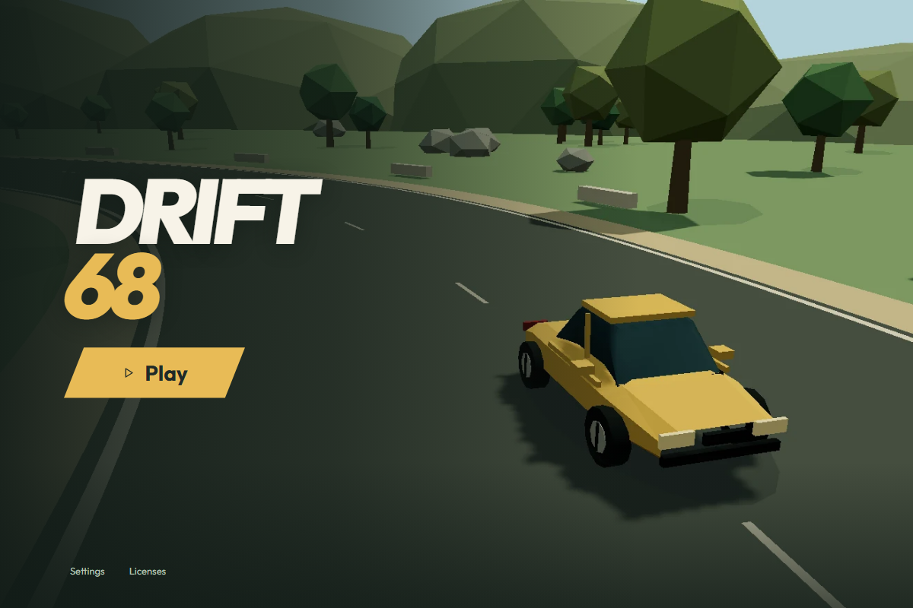

# Drift 68

**Code. Drift. Relax.** A small 3D drifting game in VS Code. Take a lap along the coast, find your line in the mountains, or unwind beneath autumn trees. Solo works offline.



Choose from four cars and three closed circuits. Chase a personal best in Lap Challenge, take an untimed Zen Drive, or invite a friend to an online 1v1. Procedural low-poly scenes, synthesized audio, and local records. Drift 68 has no accounts or telemetry, loads its assets locally, and does not read your source files.

## Install locally

1. In desktop VS Code 1.110 or later, open **Extensions → … → Install from VSIX…**.
2. Choose the VSIX from [GitHub Releases](https://github.com/aswin-panengal/drift-68/releases), or build one with `npm run package`.
3. Open **Explorer → Drift 68**, then select **Play**. If the view is missing, right-click the Explorer section headings and enable it.

You can also run `code --install-extension "path/to/drift-68-1.1.2.vsix"`.

For comfortable sidebar play, drag the Drift 68 section's upper divider to give it around 360–600 pixels of height. VS Code controls this size.

If you installed a prerelease under a different extension ID, disable it to avoid duplicate commands and views. VS Code stores Solo records separately for each extension ID.

## Take a drive

Choose **Play → Solo** to pick your car, circuit and drive mode on one screen. Use **Left / Right** to change the focused choice and **Up / Down** to switch between the car and circuit. Select **Head to the start** and click the road. Hovering never takes keyboard focus. Menus stay paused until you deliberately resume. The arrow icon opens a single editor tab. The editor has **Maximize / Restore Editor** and **Return to Explorer** controls. Maximization enlarges the editor group inside the workbench; it does not enter OS fullscreen or change your sidebar preferences.

| Input | Action |
| --- | --- |
| W / Up | Accelerate |
| S / Down | Brake, then reverse |
| A / Left, D / Right | Steer |
| Space | Handbrake / initiate a slide |
| Shift | Use earned boost |
| R | Reset to the last ordered checkpoint; clears combo |
| V / C | Cycle elevated, close, overhead, and rear chase cameras |
| M | Toggle sound |
| N | Toggle the minimap |
| H | Toggle lap time and HUD details |
| Esc | Pause / close a menu |

Open **Keyboard shortcuts** in the pause menu for the full list.

Turn in and tap **Space** to start a slide. Keep some throttle on after releasing Space to carry the drift, and steer against the slide or lift off the throttle to regain grip. Rear tires leave tracks and emit more smoke as slip increases, including in Zen Drive. Choose **Rear chase** in Settings or cycle to it with **C** for a view from behind the car.

[Rear chase screenshot](docs/screenshots/rear-chase.png)

Drifting above roughly 25 km/h on the course earns points and boost. Link slides to build a multiplier up to ×5. Straights bank the combo after a short grace period. Major boundary impacts discard unbanked points. Revisiting the same stretch cannot farm more points. Cross all 12 checkpoint gates in order to finish. Records are separate for each car/circuit pair.

Zen Drive has no competitive finish or score display. Standard gamepads use left stick, right trigger for throttle, left trigger for brake, A for handbrake, B for boost, and Start for pause. Polling stops when focus leaves the game.

## Multiplayer

The extension connects to the hosted room server automatically when you create or join a room.

1. Select **Play → 1v1**. The host picks a circuit and **1, 3, or 5 laps**, creates a room, and shares its eight-character code.
2. The other player enters the code and joins. Each player drives the car they selected in Solo setup.
3. The host selects **Start race**. Both players select **Ready to drive** to start and again after a pause. The first player to finish the selected laps wins.

Rooms hold two players and require no accounts. The room server receives the room code, race settings, player car selection, a temporary reconnect token, and live driving updates. An unexpected disconnect reserves the slot for 30 seconds. Moving between the sidebar and editor leaves the room. Opponent cars can pass through each other, and race results are for casual play with friends. Personal records come from Solo. The service is hosted on Cloudflare. The game clears its room state when a room expires. See the multiplayer documentation for retention and connection details. If the server cannot be reached, return to the mode picker to play Solo.

To use a different room server, both players can override `driftBreak.multiplayer.serverUrl` in VS Code User Settings. [Local development and Worker deployment](docs/MULTIPLAYER.md)

## A good neighbor to your editor

Driving controls belong only to the clicked game viewport. Pointer exit, focus loss, tab switching, window deactivation, hiding, and menus clear pressed keys and stop simulation/audio. Hidden views release WebGL resources. A host coordinator suspends and snapshots one view before initializing the other. No global driving shortcuts are registered.

Graphics offer Auto, Low, Medium and High. Sidebar play targets 30 FPS with a capped resolution; editor play targets up to 60 FPS. Auto reduces resolution under sustained slow rendering. High enables a small shadow map. Sound defaults off. Settings and best scores live in VS Code global storage, never in your project. Unsupported/corrupt saves recover to defaults. **Reset local records** asks for confirmation.

## Development

Requires Node.js 22.12+ (Node 24 used for verification), npm, and desktop VS Code 1.110+.

```sh
npm ci
npm test
npm run build
npm run worker:check
npm run package
```

Press **F5** with the **Run Drift 68** launch configuration for an isolated Extension Development Host. `npm run dev` opens the browser version for local development.

### Test a release build

```sh
python -m pip install playwright psutil
python -m playwright install chromium
npm run test:extension
npm run test:workbench -- drift-68-1.1.2.vsix
```

The workbench suite installs the VSIX into a fresh profile and plays a complete scoring lap with simulated standard gamepad input. It checks keyboard input, view switching, record persistence, and reset confirmation. Reports and screenshots go under `test-results/`. Run `npm run test:browser` with `npm run dev` active for the standalone game suite.

VS Code test runners download the stable desktop build by default. Set `DRIFT_VSCODE_VERSION=1.110.0` to test the minimum supported version, or set `DRIFT_VSCODE_PATH` to an existing desktop executable. `npm run test:extension` uses the built project by default and accepts `DRIFT_EXTENSION_PATH` for an installed package directory.

### Release builds

The extension ID is `aswin-dev.drift-68`. GitHub Actions lints, tests and packages each push and pull request. See the [release checklist](https://github.com/aswin-panengal/drift-68/blob/main/docs/RELEASE.md) for GitHub artifacts, version checks, and the approval required for Marketplace publishing.

## Host the browser version

The standalone browser build requires WebGL 2 and a keyboard or supported gamepad. Run `npm run build` and serve all of `dist/webview/`, including the licenses copied by the build. Browser saves belong to the browser profile and site address. To enable 1v1, set `VITE_DRIFT_MULTIPLAYER_URL` to the secure room server origin before building, then host the browser build over HTTPS. The extension package runs in desktop VS Code. For browser play, use the standalone build.

Development-only `?debug` enables FPS, frame interval, draw calls, triangles, heap (when available), resolution, view and update counts. Production builds remove the debug probe and overlay activation. Menus render on demand; no hidden high-frequency loop is required.

See [architecture](docs/ARCHITECTURE.md), [acceptance evidence and manual checklist](docs/ACCEPTANCE.md), [performance measurements](docs/PERFORMANCE.md), [known limitations](docs/KNOWN_LIMITATIONS.md), and [third-party notices](THIRD_PARTY_NOTICES.md). Original project code is MIT licensed. Report problems in [GitHub Issues](https://github.com/aswin-panengal/drift-68/issues).

## Author

Aswin Panengal
